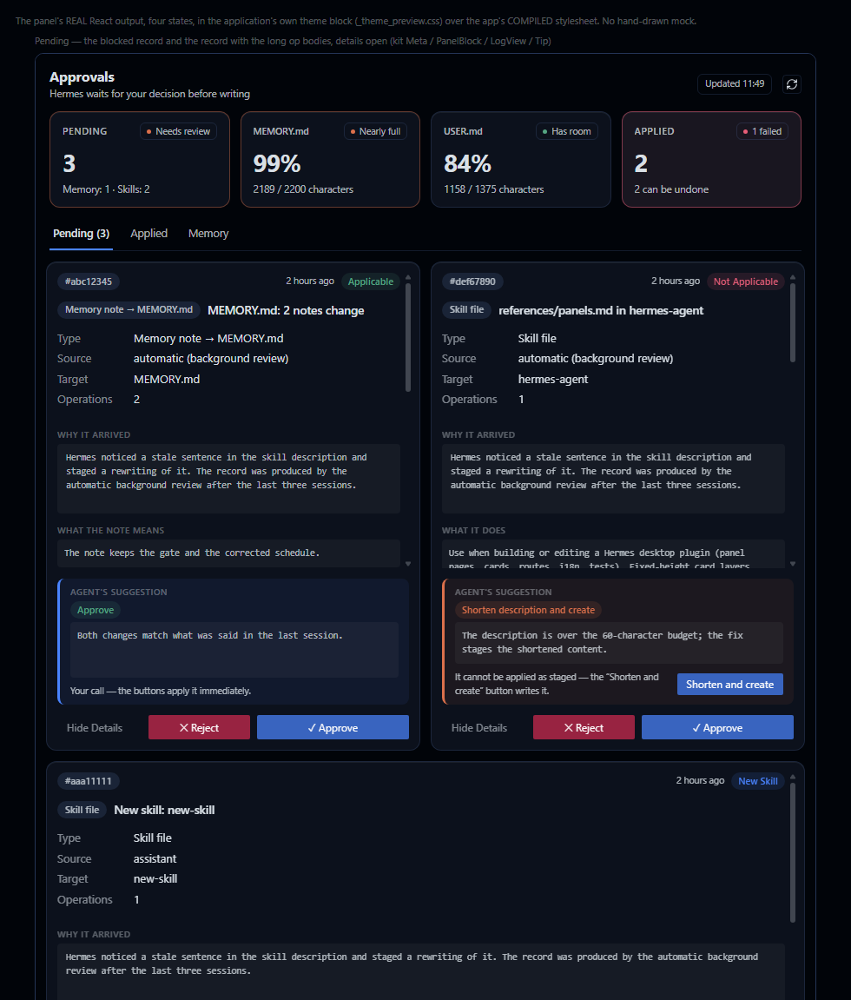
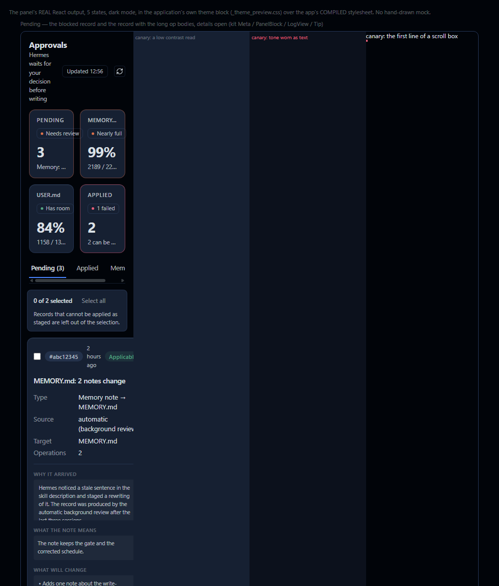

# Approvals

A Hermes **Desktop** (and Dashboard) plugin for the memory and skill writes Hermes is *holding for
approval*: what is waiting, why it arrived, what approving would change, what the agent suggests — and
an undo path for everything already applied.

Plugin id `pending-approvals` · label **Approvals** · route `/approvals` · MIT.

## Why it exists

Hermes can hold a memory/skill write instead of saving it immediately (`memory.write_approval`). The
chat tells you a write is waiting; this panel is where you inspect it and decide:

* **Pending** — one card per waiting record: type, source, target, operations, why it arrived, what
  will change, what approving does, the agent's own suggestion, and (for a skill description over the
  budget) the shortened alternative with a "Shorten and create" action.
* **Applied** — every approve, reject, outside change and failed attempt, with per-record **Undo**.
* **Memory** — the live `MEMORY.md` / `USER.md` entries with the budget they consume, and a two-step
  delete (adding a note stays a chat action — the panel does not invent a second write path).

Approve and reject call the same function the `/memory approve` command uses, success is read from the
record leaving the pending directory (never from a message), and the "before" copy of every touched
file is stored before the write so undo can restore it. Nothing is removed from view by the panel.

**Read `Docs/pending-approvals-notes.md` before changing anything** — the panel and the backend carry
no comments and no docstrings on purpose, and that file holds the reasoning behind every rule the
gates enforce.

## Screenshots

The four-frame preview (blocked record + long op bodies, the multi-skill group, the Applied tab after
a conflict, the Memory tab with a delete armed), drawn from the panel's real React output:



The contrast gate's negative control (a low-contrast read and a tone token worn as text, both caught):



## Install

`HERMES_HOME` is the install root: `%LOCALAPPDATA%\hermes` on Windows, `~/.hermes` otherwise
(`hermes -p <profile>` uses a profile root instead).

```bash
hermes plugins install thealps01-netizen/hermes-approvals-ui --enable   # from GitHub
```

From a local clone instead:

```bash
git clone https://github.com/thealps01-netizen/hermes-approvals-ui "$HERMES_HOME/plugins/pending-approvals"
hermes plugins enable pending-approvals
```

The **Desktop** page loads a *copy* of the panel, not the file in `plugins/`:

```bash
mkdir -p "$HERMES_HOME/desktop-plugins/pending-approvals"
cp "$HERMES_HOME/plugins/pending-approvals/desktop/plugin.js" \
   "$HERMES_HOME/desktop-plugins/pending-approvals/plugin.js"
```

Then enable `Approvals` in **Settings → Plugins** if it shows as disabled, and restart the desktop app
(nav items and routes are registered at load). The sidebar entry, the `Open Approvals` command and the
status-bar chip appear with it. Every edit to `desktop/plugin.js` needs the copy step repeated — the
`installed copy` rule in the static audit fails when the two drift apart.

## Gates

Six gates; each runs the real file, none reads the source as text to decide behaviour. The long form —
what every rule and every measurement asserts — is in [`tests/README.md`](tests/README.md).

| Gate | Command (from `tests/`) | Proves |
|---|---|---|
| Static audit | `python audit_static.py` | One `en` bundle reaching `ctx.i18n.register`, every `t()` key resolving, no language switch left, no `panes` claim, no comment/docstring, loader-safe imports, host-kit usage, theme variables only, the two-step delete/clear/force-undo intact, one version across the manifests, and the installed copy byte-identical to the repo file |
| Canary run | `python canary_audit.py` | That the audit **can** fail: one violation injected per rule, exit 1 with that rule's message, file restored byte for byte, audit green again |
| Render/behaviour | `node render_check.mjs` | jsdom + real React + a host-kit stub: registration, the kit skeleton, no native `title=`, accessible names, the blocked-record lock, the description fix, details/diff, two-step destructive actions, KPI + chip, FLIP, English text under two app locales |
| Static preview | `node preview.mjs` | The four frames rendered into `preview.html` inside the app's own theme and compiled stylesheet; fails on a raw `pa.*` key or a native `title=` |
| Real render + WCAG | `node shot.mjs preview.html preview.png` | The only gate that paints and measures pixels (Electron/Chromium): overflow, clipped text, native controls, kit traces, the declared layer heights read back from the screen, and every painted text node's contrast ratio (4.5:1 / 3:1) |
| Backend selftest | `PYTHONPATH="$HERMES_AGENT_DIR" "$CORE_PYTHON" ../dashboard/plugin_api.py --selftest` | The whole approve → history → undo loop against a throwaway `HERMES_HOME`: partial skill approval, the conflict path, force-undo, memory arithmetic, the patch precheck against the real target file, and the dead-approve block |

```bash
cd tests
npm ci                     # jsdom + React for the two jsdom gates
python audit_static.py && python canary_audit.py
node render_check.mjs && node preview.mjs && node shot.mjs preview.html preview.png
PA_CONTRAST_CANARY=1 node shot.mjs preview.html canary.png   # the contrast gate must go red
```

## Portability

The gates refuse to guess where your Hermes lives. Each path is env-first with a documented default,
and a gate that needs a piece it cannot find says so by name instead of quietly narrowing itself:

| Variable | Default | What it points at |
|---|---|---|
| `HERMES_HOME` | `%LOCALAPPDATA%\hermes`, else `~/.hermes` | the install root (the installed desktop copy lives here) |
| `HERMES_AGENT_DIR` | `<HERMES_HOME>/hermes-agent` when present | the core checkout — the backend's imports and the app's stylesheet/CSS tokens |
| `HERMES_PYTHON` | the core's own venv, else the running interpreter | the interpreter the backend selftest runs under |
| `HERMES_ELECTRON` | the core's `apps/desktop/node_modules/electron` | the binary the measured render gate launches |

`python env.py` (in `tests/`) prints what a run resolved. Without a core checkout the audit and the
preview still run — they report the missing piece (`CSS variable check skipped`, `kit stylesheet NOT
FOUND`) instead of pretending the check passed.

## Continuous integration

`.github/workflows/ci.yml` runs on Ubuntu and Windows: the static audit, the canary suite, the jsdom
render check and the static preview. It also checks out the core **sparsely and pinned** (`apps/desktop/src`
at `CORE_SHA`) and exports it as `HERMES_AGENT_DIR`, so the audit's CSS-token rule really runs in CI
instead of skipping itself.

Two gates stay local, and the reason is the same for both: they need a **real install**, which CI
cannot build. The backend selftest imports the core's own modules (`tools.write_approval`,
`hermes_cli.write_approval_commands`, `tools.memory_tool_store`, `agent.skill_utils`) and has to
compare behaviour against the core that is actually running — Hermes ships through its installer,
Docker and Nix and refuses to build a wheel (verified: installing `hermes-agent @ git+…@<sha>` stops
with *"Building wheels or sdists for hermes-agent is not supported"*), and the newest PyPI wheel,
0.19.0, predates `tools/memory_tool_store.py`. The measured render and its contrast gate need the
app's own Electron (a desktop Chromium session) plus its compiled stylesheet. Run both before
releasing — they are the two gates that see what jsdom cannot.

## Safety model

* **One write path.** Approve/reject delegates to the same handler `/memory approve` uses; the panel
  never writes a memory or a skill file itself.
* **Undo is real.** The before-copy of each touched file is stored with the record; undo restores it.
  A file that changed *after* the record was written asks for **Force undo** and says what else would
  be discarded.
* **Destructive actions are two-step.** Deleting a memory note, clearing the history and force-undo all
  require the confirming click; nothing is sent before it.
* **A blocked record is named before you click, and never half-applied.** The precheck (the skill
  description over the prompt budget, a patch that no longer matches its target, a memory note that
  would overflow the file) lists the reason under **Why It Can't Be Applied** and recommends Reject;
  where a repair exists — the description fix — Approve stays disabled with the reason in its themed
  tooltip and the card offers **Shorten and create** instead. Approving a blocked record anyway is
  possible and harmless: the write path refuses it, nothing is written, and the refusal is recorded
  on the card as **Approve Failed Before**.
* **No silent truncation.** An operation body is drawn whole in its own scrolling box with its size in
  the label; the backend caps a body at 20 000 characters and still reports the full length.
* **Outbound content is inspection only.** The panel reads memory and skill state; it never uploads
  anything and holds no credentials of its own.

## Language

One English bundle, registered through `ctx.i18n.register` and resolved through the **application's**
active language (`usePluginI18n` inside React, `ctx.i18n.t` for the label read at register time). There
is no in-panel language picker, no `lang` state and no `?lang=`: a second source of truth could only
contradict the app. The backend keeps one English message table behind `_tx(...)`.

## Layout

```
plugin.yaml                  identity, version, license, homepage
dashboard/manifest.json      Dashboard manifest (same version)
dashboard/plugin_api.py      FastAPI router: pending list, decide, fix, undo, memory, history
desktop/plugin.js            the Desktop panel (ESM disk plugin, no build step)
Docs/pending-approvals-notes.md   why every rule and every pixel decision exists
tests/                       the six gates + their fixtures, stubs and committed evidence PNGs
CHANGELOG.md                 what shipped when
```

## Versioning

`plugin.yaml` is the source of the version; `dashboard/manifest.json` and the top `CHANGELOG.md`
heading must match it, and the static audit fails when they do not. Release checklist: bump the three,
run all six gates, re-copy the desktop panel, then tag.

## License

MIT — see [LICENSE](LICENSE). Copyright (c) 2026 Muhammed Enes Alpler.
